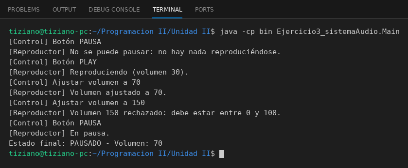

# ReproductorAudio

Programación II - Unidad 2 - Ejercicio 3

## Consigna
Un ControlRemoto envía mensajes de control (reproducir, pausar, volumen) a un ReproductorAudio, que valida que su estado nunca sea inválido.

## Lógica
- `ReproductorAudio`: atributos `volumenActual` y `estado` (REPRODUCIENDO, PAUSADO, DETENIDO).
- Validaciones: el volumen debe estar entre 0 y 100 y no se puede pausar si no se está reproduciendo; los mensajes inválidos se rechazan sin alterar el estado.
- `ControlRemoto`: mantiene una asociación con el reproductor y traduce cada botón en una llamada a un método del reproductor.
- `Main`: secuencia pausar (rechazado), reproducir, subir volumen, volumen inválido (150) y pausar.

## Ejecución

